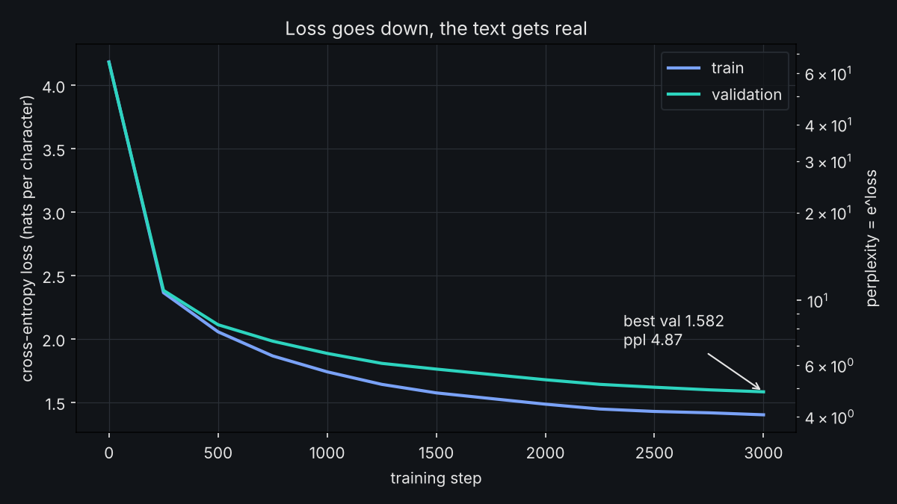
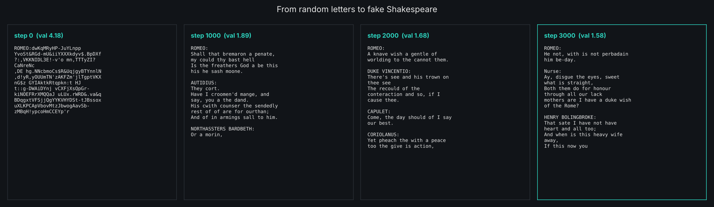
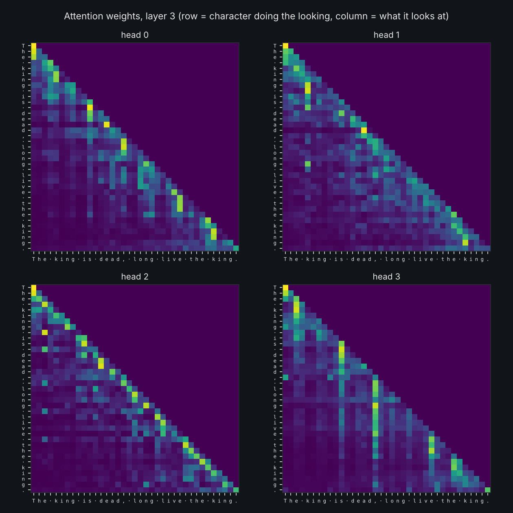

# Tiny GPT from scratch

A character-level GPT, written from first principles in about 200 lines of PyTorch,
trained on the complete works of Shakespeare (well, 1.1 million characters of them).
It works the same way ChatGPT does at its core. It is just a few thousand times smaller,
small enough to train on a laptop CPU in minutes.

You watch it go from random letters to something that looks like a play:

```
step 0     ROMEO:dwKqMRyHP-JuYLnpp YvoSt&RGd-mU&iiYXXXkdyv$.BpDXf?:,VKKNIDL3E!
step 250   I the I me se I copotr m gu tot wor:
step 1000  Shall that bremaron a penate, my could thy bast hell
step 3000  JULIET:
           I know your fathers, lord, though it help,
           To the strible that is we maid to the hand,
           That I will thou most that do you are blood false.

           GLOUCESTER:
           What that the perfection at the soldiers,
```

Those are real outputs from the default laptop run (0.8M parameters, 12 minutes on 4 CPU
cores, validation loss 4.17 down to 1.58). It learned spelling, line breaks, speaker
names in capitals and the rhythm of verse purely from predicting the next character.

| loss curve | what it wrote over time |
|---|---|
|  |  |



*Last-layer attention for "The king is dead, long live the king." Each head learned a
different habit: some look at the previous few letters, some jump back to the start of the
current word or to the last space.*

## Quick start

```bash
python -m venv .venv && source .venv/bin/activate   # Windows: .venv\Scripts\activate
pip install -r requirements.txt

python data/prepare.py          # download Shakespeare, build the vocabulary (1 second)
python train.py                 # train the laptop model (CPU, about 12 minutes)
python sample.py                # write new Shakespeare
python sample.py --interactive  # type a prompt like HAMLET: and watch it continue
python visualize.py             # draw the loss curve, attention maps and progress
python -m pytest tests -q       # 8 checks that the model is wired correctly
```

Have a GPU? Use a bigger preset. The `gpu` preset is the classic 10.6M-parameter model:

| preset | where it runs | params | layers x heads x width | context | time | val loss |
|---|---|---|---|---|---|---|
| `cpu` (default) | any laptop | 0.8M | 4 x 4 x 128 | 128 chars | ~12 min (4 cores) | 1.58 (measured) |
| `mps` | Apple Silicon Mac | 2.7M | 6 x 6 x 192 | 256 chars | ~10-15 min | ~1.5 |
| `gpu` | NVIDIA GPU | 10.6M | 6 x 6 x 384 | 256 chars | ~3-5 min | ~1.47 |

```bash
python train.py --preset gpu
python sample.py --ckpt out/gpu/ckpt.pt --temperature 0.7
```

Every setting can be overridden: `python train.py --n-layer 2 --max-iters 500 --lr 3e-3`.
Train on your own text with `python data/prepare.py --input my_book.txt --out data/mybook`
and then `python train.py --data data/mybook`.

## What's in the box

```
tinygpt/model.py      the transformer: attention, MLP, blocks, generation, KV cache
tinygpt/tokenizer.py  character <-> integer
data/prepare.py       download text, encode it, split train / validation
train.py              training loop: AdamW, warmup + cosine LR, grad clipping, checkpoints
sample.py             text generation with temperature, top-k and top-p, streaming output
visualize.py          loss.png, attention.png, progress.png
tests/test_model.py   catches the classic bugs (peeking at the future, broken cache, ...)
```

## How it works, in six steps

### 1. Text becomes numbers

Shakespeare uses 65 distinct characters (letters, punctuation, space, newline). Each one
gets an id: `\n`=0, ` `=1, ..., `z`=64. The whole play becomes one long list of integers.
That's the tokenizer. Real LLMs use sub-word tokens (about 100,000 of them) instead of
characters, but the idea is identical.

### 2. The one and only job: guess the next character

Take any 128-character window of text. The input `x` is characters 0..127 and the target
`y` is characters 1..128. At every position the model has to guess the next character.
One window gives 128 training examples at once. (`Batcher` in `train.py`.)

The score is **cross-entropy loss**: minus the log of the probability the model gave the
right answer. A model that guesses uniformly among 65 characters scores
`ln(65) = 4.17`. **Perplexity** is `e^loss`: "the model is as unsure as if it were picking
between this many characters". It starts at 65 and ends at 4.87 for the cpu model.

### 3. Embeddings

Each character id looks up a learned vector of 128 numbers (`tok_emb`), and each
position 0..127 looks up another (`pos_emb`). They are added together. Without the position
vector, the model could not tell "dog bites man" from "man bites dog".

### 4. Attention: characters looking back

This is the heart of it, in `CausalSelfAttention`:

```
Attention(Q, K, V) = softmax( Q K^T / sqrt(d_k) ) V
```

Every character makes three vectors:
- a **query**: "what am I looking for?"
- a **key**: "what do I contain?"
- a **value**: "what will I pass on if you pick me?"

The dot product of my query with every earlier key says how relevant each earlier
character is to me. Softmax turns those scores into weights that add up to 1, and I take
the weighted average of their values. Dividing by `sqrt(d_k)` stops the scores from getting
so large that the softmax saturates.

The **causal mask** sets the score for every future character to minus infinity, so after
softmax its weight is exactly 0. A character may only look back. That is why the attention
picture is a triangle. `test_causal_mask_no_peeking` checks it: changing character 10 must
not change any prediction before position 10.

**Multi-head**: the 128-wide vector is split into 4 heads of 32. Each head does its own
attention, so one head can track "am I inside a word" while another tracks "who is
speaking". Run `python visualize.py` and look at `attention.png` to see different heads
doing different things.

### 5. The transformer block

```
x = x + Attention(LayerNorm(x))   # communicate: gather information from earlier characters
x = x + MLP(LayerNorm(x))         # compute: think about it, position by position
```

The MLP expands to 4x width, applies GELU, and projects back. The `x + ...` residual
connections let gradients flow straight through deep stacks. LayerNorm before each
sub-layer ("pre-norm") keeps training stable. Stack 4-6 of these blocks and the model
picks up spelling, then words, then whole lines of dialogue with speaker names.

At the end, a final LayerNorm and one linear layer turn each vector into 65 scores
(logits), one per possible next character.

### 6. Generating text

Feed in a prompt, take the scores for the last position, divide by a **temperature** T,
softmax, and sample:

```
x_{t+1} ~ softmax(z_t / T)
```

Append the sampled character and repeat. Low temperature (0.5) is safe and repetitive,
high (1.2) is creative and messy. `--top-k 20` only allows the 20 most likely characters,
`--top-p 0.9` only allows the smallest set covering 90% of the probability.

## The "enhanced" parts

Things this version does beyond the minimum, all the same techniques real LLMs use:

- **KV cache.** When generating, the keys and values of earlier characters don't change,
  so they are stored and reused. Each new character costs one position of compute instead of
  re-running the whole context. `test_kv_cache_matches_full_forward` proves the output is
  identical.
- **Weight tying.** The input embedding and the output layer share one matrix (fewer
  parameters, better results).
- **GPT-2 initialisation.** Small random weights, with the residual projections scaled down
  by `1/sqrt(2 * layers)` so deeper models start stable.
- **AdamW with selective weight decay.** Matrices are decayed, LayerNorm and biases are not.
- **Learning rate schedule.** Linear warmup, then cosine decay to 10% of peak.
- **Gradient clipping** at norm 1.0, so one bad batch can't blow up training.
- **Mixed precision** (bfloat16) and optional `torch.compile` on NVIDIA GPUs.
- **Best-checkpoint saving and `--resume`.**
- **Progress samples.** Every evaluation writes a sample to `samples.jsonl`, so you can
  read how the model's writing evolves.
- **Validation on unseen text.** The last 10% of Shakespeare is held out. When train loss
  keeps falling but validation stops, the model has started memorising (overfitting).
  That's what `dropout` fights.


## Further reading

- Vaswani et al., *Attention Is All You Need* (2017), the original transformer paper.
- Radford et al., *Language Models are Unsupervised Multitask Learners* (2019), GPT-2.
- Andrej Karpathy's "Let's build GPT" video, the classic walkthrough of this exact exercise
  (this code is an independent write-up, not a copy).
